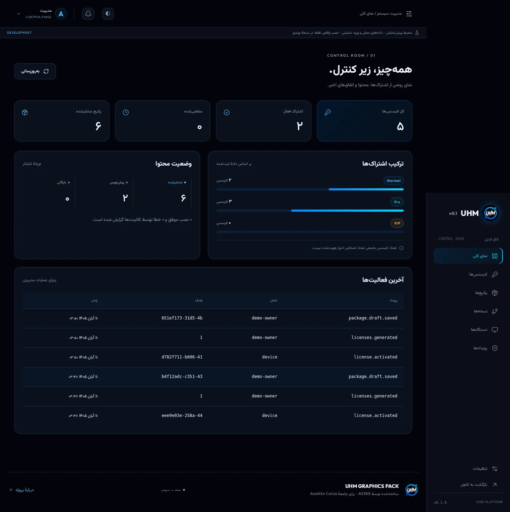

<div align="center">


# UHM Launcher & License Platform

**لانچر ویندوز، کاتالوگ و پنل مدیریت محتوای Assetto Corsa**

[وب‌سایت](https://aliam664.github.io/App/) · [پنل مدیریت](https://aliam664.github.io/App/#/admin) · [دانلود نسخه جدید](https://github.com/aliam664/App/releases/tag/uhm-launcher-v0.1.2) · [راهنمای مدیریت](docs/admin-guide-fa.md) · [گزارش مشکل](https://github.com/aliam664/App/issues)

   

</div>

> **خلاصه صادقانه:** UHM یک وب‌سایت صرف نیست؛ یک رابط مشترک وب و اپ دسکتاپ، API لایسنس و مدیریت و موتور نصب ویندوز دارد. نسخه **0.1.2 پیش‌انتشار** در ۴ نوامبر ۲۰۲۶ منتشر شده و قسمت‌های مهمی پیاده‌سازی و آزمایش شده‌اند، اما پروژه هنوز تأییدیهٔ آمادگی تجاری بدون محدودیت ندارد. اجرای واقعی روی رایانهٔ کاربر با بازی و مود واقعی، آزمون‌های امنیتی و عملیاتی بیشتر و چند تصمیم محصولی باقی مانده‌اند.

---

## فهرست مطالب

- [انتشارها و دانلود](#انتشارها-و-دانلود)
- [پروژه چیست و چگونه کار می‌کند؟](#پروژه-چیست-و-چگونه-کار-میکند)
- [آیا پروژه کامل است؟](#آیا-پروژه-کامل-است)
- [راهنمای کاربر](#راهنمای-کاربر)
- [راهنمای مدیر](#راهنمای-مدیر)
- [معماری و ساختار مخزن](#معماری-و-ساختار-مخزن)
- [اجرای محلی و توسعه](#اجرای-محلی-و-توسعه)
- [ساخت نسخه ویندوز](#ساخت-نسخه-ویندوز)
- [تست، امنیت و عملیات](#تست-امنیت-و-عملیات)
- [عیب‌یابی و اسناد بیشتر](#عیبیابی-و-اسناد-بیشتر)

## انتشارها و دانلود

| انتشار | وضعیت و کاربرد | دریافت |
| --- | --- | --- |
| **UHM Launcher 0.1.2** | جدیدترین انتشار زمانی؛ **پیش‌انتشار** لانچر و پلتفرم جدید، Windows x64؛ ۲۰۲۶/۱۱/۰۴ | [نصاب مستقیم](https://github.com/aliam664/App/releases/download/uhm-launcher-v0.1.2/UHM-Launcher-0.1.2-x64-setup.exe) · [جزئیات، امضا و هش](https://github.com/aliam664/App/releases/tag/uhm-launcher-v0.1.2) |
| **UHM Pack Installer 1.0.0** | انتشار قدیمی‌تر؛ GitHub آن را به‌عنوان آخرین انتشار غیرآزمایشی (`Latest`) نشان می‌دهد. پروژه/نسخه جدید 0.1.2 را با آن اشتباه نگیرید. | [صفحه انتشار قدیمی](https://github.com/aliam664/App/releases/tag/v1.0.0) · [نصاب قدیمی](https://github.com/aliam664/App/releases/download/v1.0.0/UHM.Pack.Installer_1.0.0_x64-setup.exe) |
| **Update feed** | متادیتای قابل تغییر کانال آپدیت؛ خود فایل نصب نیست. | [latest.json](https://github.com/aliam664/App/releases/download/uhm-launcher-updates/latest.json) |

**نصاب 0.1.2:** 16,462,582 بایت، SHA-256 برابر با:

```text
c13afbcc883fed9b484df4ab9b0103da38844981c9b77c6813c8ef7c8d84b395
```

برای مقایسه در PowerShell، پس از دانلود از لینک رسمی:

```powershell
Get-FileHash -Algorithm SHA256 .\UHM-Launcher-0.1.2-x64-setup.exe
```

مقدار را با `SHA256SUMS.txt` در همان صفحه انتشار و مقدار بالا مقایسه کنید. هش به‌تنهایی گواهی هویت ناشر نیست. updater از امضای نسخه‌مقید استفاده می‌کند، ولی **نصاب گواهی Windows Authenticode ندارد** و ممکن است SmartScreen هشدار دهد؛ منبع و ریسک را خودتان بررسی کنید. از منابع غیررسمی یا فایل تغییرکرده استفاده نکنید.

سورس binary منتشرشده commit [`ffc9a4ad`](https://github.com/aliam664/App/commit/ffc9a4ad178b79251b20f58c413626d2d17e647e) است. این مخزن علاوه بر آن، مستندات و متادیتای بعد از انتشار تا `2a5ce138` را در بر می‌گیرد؛ تغییر README یا ادغام آن به معنی ساخت مجدد EXE یا انتشار نسخه جدید نیست. [گزارش انتشار](docs/release-0.1.2-fa.md) و [دفتر استقرار](docs/rollout-0.1.2.md) شواهد تفصیلی را دارند.

## پروژه چیست و چگونه کار می‌کند؟

UHM برای ارائه و مدیریت محتوای مرتبط با **Assetto Corsa** طراحی شده است. مدیر، بسته‌ها و مجوزها را در پنل تعریف می‌کند؛ کاربر با لایسنس فعال کاتالوگ را می‌بیند و در نسخه دسکتاپ می‌تواند عملیات Native پشتیبانی‌شده را انجام دهد. سه سطح اشتراک `Normal`، `Pro` و `VIP` و نقش‌های مستقل مدیریتی وجود دارند.

```text
  مرورگر / سایت ───────┐
                        ├── رابط مشترک TypeScript / Vite
  لانچر Windows / Tauri ┘          │
             │                     ▼
             │              API / Supabase Edge
             │                     │
             │              PostgreSQL + RLS
             ▼
  موتور Rust: بررسی طرح، دانلود، هش، staging و نصب روی مسیر مجاز بازی
             │
             └── فایل بسته از میزبان HTTPS مستقل مدیر دریافت می‌شود
```

- **وب:** رابط، کاتالوگ و پنل را ارائه می‌دهد؛ مرورگر به فایل‌های بازی دسترسی Native ندارد و نصب واقعی را شبیه‌سازی نمی‌کند.
- **دسکتاپ:** همان رابط را داخل Tauri اجرا می‌کند و فرمان‌های Native برای شناسایی بازی، دانلود، نصب و کتابخانه در اختیار دارد.
- **API:** اعتبار لایسنس، اثبات دستگاه، سطح دسترسی، بسته‌ها و عملیات مدیر را سمت سرور بررسی می‌کند. رابط به‌تنهایی مرز امنیتی نیست.
- **میزبانی فایل:** فایل مودها در بسته برنامه یا پایگاه داده قرار نگرفته‌اند؛ مدیر باید فایل معتبر را جداگانه میزبانی و لینک مستقیم، اندازه و هش آن را ثبت کند.

## آیا پروژه کامل است؟

**پاسخ کوتاه: خیر، محصولی با قابلیت‌های قابل توجه و انتشار آزمایشی است، نه محصول نهایی اثبات‌شده در همه شرایط.** جدول زیر بین وجود قابلیت، آزمایش و آمادگی عملیاتی تفاوت می‌گذارد.

| بخش | آنچه در سورس/گزارش انتشار وجود دارد | محدودیت یا وضعیت باقی‌مانده |
| --- | --- | --- |
| رابط وب و دسکتاپ | رابط مشترک، فارسی و RTL، تم و پنل واکنش‌گرا | تجربه مرورگر جایگزین نصب Native نیست؛ اتصال سرویس و دسترسی‌ها لازم است. |
| لایسنس و دستگاه | فعال‌سازی، سطح اشتراک، اثبات کلید دستگاه، تمدید و مدیریت | کلید مرورگر و Windows مستقل‌اند؛ کنترل کامل دستگاه یا جلوگیری از بازنشر فایل دانلودشده تضمین نمی‌شود. |
| پنل مدیریت | نقش‌ها، مجوزهای جزئی، کاربران، لایسنس، دسته‌ها، پکیج، audit و گزارش‌ها | داده و امکانات مطابق مجوز و قابلیت‌های API نمایان می‌شوند؛ عملکرد عملیاتی به سرور وابسته است. |
| کاتالوگ و محتوا | بسته، پیش‌نیاز، چند فایل، هش، آدرس، نسخه و مراحل نصب | کاتالوگ فقط محتوای واقعاً منتشرشده را نشان می‌دهد؛ در گزارش ۴ نوامبر، **هیچ بسته عمومی منتشر نشده بود**. این عدد ممکن است تغییر کرده باشد. |
| نصب و کتابخانه | دانلود/هش، استخراج، staging، پیش‌نمایش، journal، بازیابی خرابی و scan در Native | آزمون زنجیره بسته با fixture مصنوعی انجام شده، نه بازی و مود واقعی روی رایانه کاربر. بازیابی پس از خرابی با اجازه بازنویسی فایل شخصی یکی نیست. |
| به‌روزرسانی | کانال امضاشده؛ ارتقای 0.1.1 به 0.1.2 در Windows CI با سناریوی کنترل‌شده آزموده شده است | Authenticode و delta باینری ادعا نمی‌شوند؛ موفقیت روی همه رایانه‌ها یا لایسنس Owner واقعی ثابت نشده است. |
| استقرار | طبق گزارش ۴ نوامبر، API v11 و migrationهای مربوط مستقر و smoke بررسی شدند | این وضعیت تاریخی است، نه تأیید زنده فعلی. پایش ظرفیت، بکاپ و بازیابی آزموده‌شده، load test و بررسی امنیتی بیشتر لازم‌اند. |

**موانع مهم قبل از عرضه گسترده:** آزمایش تعاملی روی Windows با بازی و بسته‌های واقعی و نسخه پشتیبان مستقل؛ بررسی امنیتی و بار مستقل؛ تصمیم‌گیری و آزمون سیاست بازگردانی فایل‌های شخصی؛ برنامه بکاپ/restore، پایش، محدودسازی ترافیک و ظرفیت؛ تعیین وضعیت گواهی ناشر ویندوز و فرآیند پشتیبانی. هیچ‌یک از تست‌های موجود، تضمین «ضدکرک مطلق» یا نصب موفق روی تمامی دستگاه‌ها نیست. گزارش‌های تاریخی ممکن است وضعیت checkpoint قدیمی را توصیف کنند؛ برای 0.1.2 ابتدا [گزارش انتشار](docs/release-0.1.2-fa.md) را بخوانید.

## راهنمای کاربر

### نصب و راه‌اندازی

1. روی **Windows 10/11 نسخه ۶۴بیتی**، [نصاب 0.1.2](https://github.com/aliam664/App/releases/download/uhm-launcher-v0.1.2/UHM-Launcher-0.1.2-x64-setup.exe) را از انتشار رسمی دریافت و هش را بررسی کنید. برای برنامه دسکتاپ WebView2 لازم است؛ اگر روی سیستم وجود ندارد، آن را از منبع رسمی Microsoft نصب کنید.
2. پیش از تغییر محتوای بازی، از پوشه و تنظیمات مهم خود **نسخه پشتیبان مستقل** بگیرید. بسته‌های آزمایشی را ابتدا فقط روی مسیر جداگانه آزمایش کنید.
3. نصاب را اجرا و لانچر را باز کنید. برای استفاده از قابلیت‌های متصل، اینترنت و لایسنس معتبر لازم است.
4. کد لایسنس را در بخش فعال‌سازی وارد کنید. اتصال دستگاه بر اساس کلید دستگاه است؛ فعال‌سازی در مرورگر و برنامه Windows می‌تواند دو هویت متفاوت ایجاد کند. اگر می‌خواهید لایسنس اصلی را در دسکتاپ استفاده کنید، آن را ابتدا در مرورگر آزمایش نکنید.
5. مسیر نصب بازی را انتخاب و اعتبارسنجی کنید؛ سپس در کاتالوگ بسته‌های مجاز را بررسی کنید. اگر بسته‌ای نیست، ممکن است هنوز محتوای عمومی منتشر نشده باشد.
6. پیش از تأیید نصب، مقصدها، پیش‌نیازها و تداخل‌ها را بخوانید. خطا، نبود فضای کافی یا لغو پیش‌نمایش را موفقیت نصب فرض نکنید. بسته‌ها و رفتارشان به فایل‌ها و تنظیمات واقعی مدیر وابسته‌اند.

### به‌روزرسانی و تعویض دستگاه

نسخه‌های سازگار با updater امضاشده، آپدیت را بررسی و در زمان امن، هنگام خروج یا اجرای بعدی، اعمال می‌کنند؛ تنظیم بررسی خودکار و بررسی دستی در نسخه جدید وجود دارد. نسخه‌های قدیمی بدون updater به دریافت دستی نصاب نیاز دارند. برای تعویض دستگاه، با مدیر درباره آزادسازی مجاز دستگاه تماس بگیرید؛ کد یا کلید دستگاه را عمومی نکنید. دسترسی آفلاین محدود است و لغو آنلاین لزوماً فوراً به دستگاهی که قطع است نمی‌رسد.

## راهنمای مدیر

1. با لایسنس مدیریتی مجاز وارد پنل شوید. نقش مدیریت از سطح VIP به‌تنهایی نتیجه نمی‌شود. برای همکاران، لایسنس جدا و حداقل مجوز لازم صادر کنید.
2. یک دسته و بسته بسازید؛ نام، سطح، توضیح، نسخه و پیش‌نیازها را مشخص کنید. فایل واقعی را در میزبان HTTPS قابل اتکا قرار دهید.
3. لینک مستقیم، SHA-256، اندازه دقیق بایت، نوع فایل، mirrorهای اختیاری و مراحل copy/extract را وارد کنید. محاسبه هش در رابط، فایل را آپلود نمی‌کند؛ EXE بسته خودکار اجرا نمی‌شود.
4. مقصدها باید نسبی و در محدوده مجاز بازی باشند. پیش‌نویس ذخیره‌شده را بررسی و در محیط جداگانه تست کنید؛ preview را بخوانید و سپس با مجوز لازم منتشر کنید.
5. انتشار دارای snapshot نسخه است؛ برای تغییر محتوای منتشرشده نسخه جدید بسازید. بازگرداندن snapshot در سرور، لزوماً فایل‌های نصب‌شده کاربران را بازنویسی نمی‌کند.
6. رویدادها، خطاها، ظرفیت و پشتیبان‌ها را پایش کنید. کد لایسنس، رمز آرشیو، توکن، کلید خصوصی و URLهای حساس را در issue عمومی ثبت نکنید.

[راهنمای عملی مدیریت با تصویر](docs/admin-guide-fa.md) · [کنسول و مجوزها](docs/admin-console-fa.md) · [عملیات و نگهداری](docs/operations-fa.md). **توجه:** مقدمه یا برخی بخش‌های این اسناد در زمان checkpointهای قدیمی نوشته شده‌اند؛ اظهارات آن‌ها درباره شماره انتشار یا نبود updater را با [گزارش نهایی 0.1.2](docs/release-0.1.2-fa.md) تطبیق دهید.



## معماری و ساختار مخزن

| مسیر | مسئولیت |
| --- | --- |
| `index.html`، `apps/web/`، `public/` | ورودی مشترک، رابط TypeScript، سبک و دارایی‌های وب/دسکتاپ |
| `packages/contracts/` | قراردادها، اعتبارسنجی، سطوح، مسیرها و برنامه‌ریزی وابستگی |
| `backend/src/` | منطق API، لایسنس، دسترسی، مدیریت، repository و امضا |
| `backend/dev/` | سرور و داده محلی مخصوص توسعه؛ برای استقرار عمومی نیست |
| `supabase/` | migrationها، تنظیمات و Edge Functions؛ داده مشتری و secret در مخزن نیست |
| `src-tauri/` | موتور Rust، مجوزهای Native، هویت دستگاه، نصب و updater |
| `config/`، `deployment/edge/` | تنظیمات عمومی و خروجی‌های استقرار؛ کلید خصوصی نباید اینجا قرار بگیرد |
| `tests/`، `.github/workflows/` | تست‌های واحد/دیتابیس/مرورگر و CI وب و Windows |
| `docs/` | اسناد معماری، گزارش انتشار، امنیت، تصاویر و راهنماها |
| `main.js`، `preload.js`، `src/` | نمونه قدیمی Electron؛ برای مرجع حفظ شده و بخشی از build جدید Tauri نیست |

انتشار قدیمی `v1.0.0` نیز طبق [بررسی سورس آن](docs/legacy-v1-review-fa.md) با **Tauri/Rust** ساخته شده است؛ وجود نمونه Electron در تاریخچه به معنی Electron بودن آن انتشار نیست.

## اجرای محلی و توسعه

### پیش‌نیازها

- Git و **Node.js 22.12 یا جدیدتر** همراه npm؛ نصب وابستگی به اینترنت نیاز دارد.
- برای اجرای/ساخت دسکتاپ: Rust stable، ابزار ساخت C++ ویندوز و WebView2؛ دستورالعمل‌ها و پیش‌نیازهای [Tauri](https://v2.tauri.app/start/prerequisites/) را نیز ببینید.
- این دستورات برای توسعه‌دهندگان‌اند؛ کاربران معمولی فقط نصاب رسمی را نیاز دارند.

```bash
git clone https://github.com/aliam664/App.git
cd App
npm ci
npm run dev
```

آدرس توسعه معمولاً `http://localhost:5173` است. `npm run dev` سرور محلی API و Vite را برای **sandbox** بالا می‌آورد؛ داده‌های آزمایشی در `.local/` نگهداری می‌شوند و کدهای آزمایشی در سرویس واقعی معتبر نیستند. حالت توسعه مجوز نمایشی Owner دارد: **آن را در شبکه عمومی یا محیط عملیاتی مستقر نکنید.** استفاده از `localhost` در این راهنما یعنی همان کامپیوتری که سرور توسعه را اجرا می‌کند.

`.env.example` فقط نمونه متغیرهای عمومی مرورگر است. `VITE_API_BASE`، `VITE_SUPABASE_URL` و `VITE_SUPABASE_PUBLISHABLE_KEY` ممکن است در build متصل استفاده شوند. هر چیزی با پیشوند `VITE_` به مرورگر می‌رسد؛ service-role، pepper، توکن، رمز یا کلید خصوصی را در آن یا Git قرار ندهید. برای ایجاد/استقرار مستقل، ابتدا [راهنمای استقرار](docs/deployment-fa.md) و تنظیمات عمومی نمونه را بخوانید؛ صرف push کردن API یا migration را deploy نمی‌کند.

| دستور | کاربرد |
| --- | --- |
| `npm run typecheck` | بررسی TypeScript بدون خروجی |
| `npm test` | تست‌های Vitest، از جمله تست‌های API و دیتابیس ایزوله |
| `npm run check` | typecheck، تست‌ها و build |
| `npm run build` | build معمولی در `dist/` |
| `npm run test:e2e` | تست مرورگر Playwright، پس از نصب مرورگر |
| `npm run test:design` | بررسی‌های رابط و دسترس‌پذیری |
| `npm run build:pages` / `npm run build:branch` | buildهای نمایشی sandbox |
| `npm run build:live-pages` / `npm run build:live-branch` | build متصل Pages / fallback شاخه |
| `npm run build:edge` | تولید artifact مربوط به Edge، نه استقرار خودکار آن |

برای مرورگر تست در محیط مناسب: `npx playwright install --with-deps chromium`. داده و محیط واقعی را با sandbox اشتباه نگیرید.

## ساخت نسخه ویندوز

در Windows و PowerShell، پس از نصب پیش‌نیازها:

```powershell
npm ci
# dot-source لازم است تا متغیرهای هش extractor در همین session بمانند.
. ./scripts/prepare-extractor.ps1
npm run desktop:dev
# برای build، ابتدا تنظیمات عمومی و trust root مناسب را آماده کنید:
npm run desktop:build
```

استخراج ZIP در Rust انجام می‌شود. برای RAR/7z اسکریپت، ابزار رسمی نسخه‌ثابت 7-Zip را با بررسی هش آماده می‌کند؛ بدون ابزار و هش معتبر این فرمت‌ها fail-closed هستند. فایل‌های تولیدی extractor در Git نیستند و مجوزهایشان باید همراه بسته بماند. build عملیاتی به `UHM_LICENSE_PUBLIC_JWK`، `UHM_LICENSE_ISSUER` و `UHM_LICENSE_KEY_ID` هماهنگ با سرور نیاز دارد؛ **کلید خصوصی را وارد build نکنید**. بسته محلی، به خودی خود همان binary امضاشده release نیست. توضیحات بیشتر: [extractor](src-tauri/resources/extractor/README.md)، [استقرار](docs/deployment-fa.md)، [updater](docs/updater-setup-fa.md).

## تست، امنیت و عملیات

### شواهد آزمون

- در بررسی محلی این شاخه در ۲۰۲۶/۱۱/۰۸: `npm ci` و `npm run check` موفق؛ **۲۲۲ تست**، typecheck و build موفق. npm audit در نصب، آسیب‌پذیری گزارش نکرد. Build هشدار اندازه chunk و چند هشدار annotation وابستگی داشت.
- این بررسی محلی روی Linux، آزمون تعاملی Windows، بازی واقعی، Rust Native یا سرویس تولید نبود.
- گزارش انتشار، [Platform checks](https://github.com/aliam664/App/actions/runs/41804408252)، [انتشار و بررسی امضا](https://github.com/aliam664/App/actions/runs/41805407297) و [ارتقای خودکار Windows](https://github.com/aliam664/App/actions/runs/41805527112) را برای commit انتشار مستند کرده است. سناریوها شامل fixture و runner ایزوله‌اند؛ با آزمون روی PC مشتری برابر نیستند.

### مرزهای امنیت و نگهداری

لایسنس و طرح نصب امضاشده، مجوزهای سمت سرور، RLS، بررسی هش و محدودیت مسیرها بخشی از طراحی‌اند؛ اما هیچ سیستمی ضدکرک مطلق نیست. DPAPI هویت نرم‌افزاری را محافظت می‌کند، نه تأیید سخت‌افزاری غیرقابل کلون. فایل مجاز دانلودشده لزوماً از بازنشر محافظت نمی‌شود. در استقرار عمومی باید ورودی قابل اعتماد، rate limiting، امنیت میزبان فایل، ظرفیت، مانیتورینگ و backup/restore مستقل بررسی شوند. گزارش [ممیزی امنیت](docs/security-audit-2026-11-03-fa.md) تاریخی است؛ اصلاح بعضی یافته‌ها در مراحل بعدی به معنی بسته‌شدن تمام ریسک‌ها نیست.

### سایت و انتشار

طبق تنظیم GitHub Pages مشاهده‌شده در ۲۰۲۶/۱۱/۰۸، سایت از ریشه شاخه `arena/37af8e92-app` با روش legacy سرو می‌شود، **نه از main**. بنابراین ادغام این سورس در `main` به‌تنهایی تغییر سایت زنده را تضمین نمی‌کند. workflow سایت برای `main` هم build می‌سازد، اما deploy در حالت Actions فقط وقتی انجام می‌شود که Pages به workflow تنظیم شده باشد؛ در حالت فعلی منبع legacy تعیین‌کننده است. تغییر تنظیم Pages، استقرار API و migrationها عملیات مستقل‌اند. [جزئیات Pages](docs/github-pages-fa.md).

## عیب‌یابی و اسناد بیشتر

| مسئله | گام پیشنهادی |
| --- | --- |
| هش فایل مطابقت ندارد | فایل را اجرا نکنید؛ از انتشار رسمی دوباره دریافت و هش را مقایسه کنید. |
| SmartScreen یا ناشر ناشناس | نسخه 0.1.2 گواهی Authenticode ندارد؛ منشأ را بررسی و با آگاهی تصمیم بگیرید. |
| مسیر بازی پیدا نمی‌شود | پوشه واقعی بازی را دستی انتخاب و وجود فایل‌های بازی را بررسی کنید؛ از پوشه آزمایشی برای تست استفاده کنید. |
| لایسنس روی دستگاه دیگر پذیرفته نمی‌شود | هویت مرورگر و دسکتاپ متفاوت است؛ با مدیر برای بررسی/آزادسازی مجاز تماس بگیرید، نه انتشار کد در issue. |
| کاتالوگ خالی است | اتصال و سطح دسترسی و وجود بسته واقعاً منتشرشده را بررسی کنید؛ خالی‌بودن الزاماً خطای UI نیست. |
| خطای دانلود یا نصب | فضای دیسک، اتصال، دسترسی مسیر و لینک/اندازه/هش بسته را بررسی کنید؛ از تغییر دستی فایل‌های بازی بدون پشتیبان بپرهیزید. |
| خطای build RAR/7z | اسکریپت آماده‌سازی extractor را در همان PowerShell اجرا و هش و پیش‌نیازها را بررسی کنید. |

- [گزارش 0.1.2، محدودیت‌ها و شواهد](docs/release-0.1.2-fa.md)
- [معماری و بازبینی](docs/architecture-review-fa.md) · [گزارش پیاده‌سازی](docs/implementation-report-fa.md)
- [استقرار](docs/deployment-fa.md) · [عملیات](docs/operations-fa.md) · [Pages](docs/github-pages-fa.md)
- [ممیزی امنیت](docs/security-audit-2026-11-03-fa.md) · [ریسک‌های عملیاتی](docs/operational-risk-review-fa.md)
- [همه انتشارها](https://github.com/aliam664/App/releases) · [Issues](https://github.com/aliam664/App/issues)

برای گزارش مشکل، نسخه، محیط، مراحل تکرار، خطای دقیق و در صورت وجود Request ID را بنویسید؛ اطلاعات محرمانه را حذف کنید. این مخزن در `package.json` با `UNLICENSED` مشخص شده و **مجوز متن‌باز اعطا نمی‌کند**؛ درباره استفاده یا بازتوزیع، از صاحب پروژه اجازه بگیرید. فونت‌ها و ابزارهای ثالث ممکن است مجوزهای جداگانه خود را داشته باشند.
