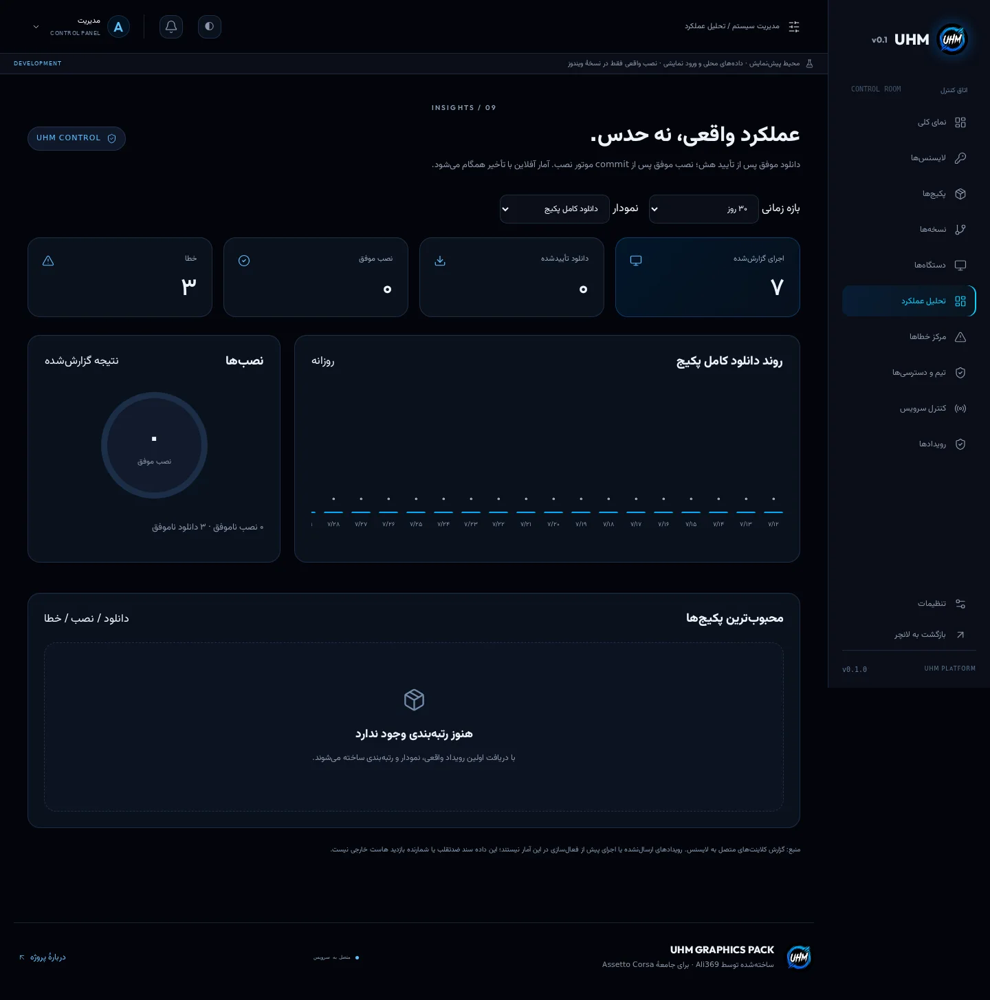
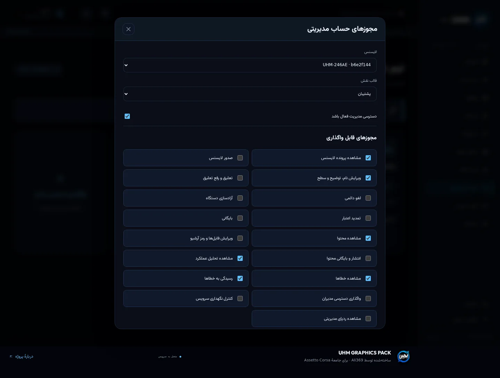

# مرکز مدیریت، ورود با لایسنس و گزارش‌های آفلاین

این قابلیت‌ها در سورس مشترک برنامه/سایت پیاده شده‌اند. دیتابیس عملیاتی یا ربات خارجی در این تغییر ساخته/متصل نشده است. پیش‌نمایش Pages همچنان sandbox مرورگر است؛ کدهای آن در محصول واقعی اعتبار ندارند.

## ورود سه یا چهار مدیر مستقل

۱. مالک یک لایسنس عادی از بخش «لایسنس‌ها» می‌سازد و کد را همان لحظه امن تحویل می‌دهد. کد کامل قابل بازیابی از دیتابیس نیست.
۲. در «تیم و دسترسی‌ها»، همان لایسنس را انتخاب و نقش/مجوزهای فرد را تنظیم می‌کند.
۳. فرد در فرم «ورود با لایسنس مدیریت» کد را وارد می‌کند. اولین فعال‌سازی به کلید همان دستگاه متصل می‌شود؛ هم اشتراک برنامه فعال است هم نشست مدیریت، اگر مالک دسترسی داده باشد.
۴. دفعات بعد روی همان دستگاه، بدون تکرار کد می‌تواند ورود کند؛ دستگاه باید challenge تازه را امضا کند. داشتن UUID لایسنس، token عادی برنامه یا کدِ متعلق به دستگاه دیگر کافی نیست.
۵. تغییر/قطع مجوز مدیریت در درخواست بعدی API بررسی می‌شود. غیرفعال‌کردن عضویت مدیریت، به‌تنهایی اشتراک برنامه را نمی‌بندد. تعلیق/لغو خود لایسنس، ورود مدیریتی آن را هم متوقف می‌کند.

نام و توضیح داخلی از فعال‌سازی عمومی به کاربر برگردانده نمی‌شود. تغییر دستگاه باید طبق سیاست تک‌دستگاهی با مالک انجام شود؛ مرورگر و Tauri هویت‌های دستگاه متفاوتی دارند، بنابراین کد فعال‌شده در یک محیط را نمی‌توان هم‌زمان روی هویت دیگر فعال کرد.

### مالک اول و بازیابی اضطراری

اولین مالک نباید به اولین بازدیدکننده سایت داده شود. اپراتور معتبر باید یک‌بار مالک را راه‌اندازی کند:

- مسیر موجود Supabase Auth + MFA برای حساب bootstrap/بازیابی حفظ شده است؛ آن مالک می‌تواند از پنل یک لایسنس را owner کند.
- یا اپراتور دیتابیس، **شناسه یک لایسنس واقعی و معتبر موجود** را در `uhm.admin_access` با `save_admin_access` به owner اختصاص دهد؛ این کار در مرورگر یا با anon/service-role عمومی انجام نشود.
- مدیران بعدی از پنل دعوتِ لایسنس‌محور استفاده می‌کنند؛ رمز عبور جداگانه لازم ندارند.

احراز هویت لایسنس‌محور، طبق درخواست محصول، **کد + اثبات مالکیت کلید دستگاه** است، نه TOTP. آن را معادل MFA ایمیل معرفی نکنید. کلید Native با DPAPI محافظت می‌شود؛ مرورگر از WebCrypto/IndexedDB استفاده می‌کند. کدهای مدیریتی را از مسیر مطمئن تحویل دهید و برای مالک، مسیر بازیابی کنترل‌شده نگه دارید.

## مجوزها

۱۷ مجوز مستقل برای مشاهده/صدور/ویرایش/تعلیق/لغو/آزادسازی/تمدید/بایگانی لایسنس، مشاهده/ویرایش/انتشار محتوا، آمار، مشاهده/رسیدگی خطا، تیم، سرویس و audit وجود دارد. نقش‌های Owner، License Manager، Content Manager، Support و Viewer قالب‌اند؛ مالک می‌تواند مجوزهای نقش‌های غیرمالک را کم/زیاد کند.

- owner همه اختیارات عملیاتی برنامه را دارد؛ تیک‌های نقش owner آن را محدود نمی‌کند.
- مدیرِ دارای `team.manage` ولی غیرمالک، نمی‌تواند owner بسازد/ویرایش کند یا مجوزی که خودش ندارد واگذار کند.
- تغییر مجوز حساب لایسنسِ فعلیِ خود، تعلیق/لغو/آزادسازی خود و حذف آخرین مالک ممنوع است.
- تغییر آخرین مالک در دیتابیس با قفل تراکنشی سراسری حفاظت می‌شود.
- نقش‌های فاقد مجوز محتوا، لینک فایل و رمز استخراج دریافت نمی‌کنند؛ تاریخچه انتشار هم این محدودیت را اعمال می‌کند.
- کلید خصوصی سرور و رمز دیگران در پنل نمایش داده نمی‌شود؛ audit از داخل برنامه حذف‌پذیر نیست.

نشست مدیریتی لایسنس JWT مستقل با `typ=uhm-admin+jwt` و عمر ۱۵ دقیقه است. نقش و مجوز از payload مورد اعتماد قرار نمی‌گیرد؛ وضعیت زنده عضویت، نسخه دسترسی، وضعیت/انقضا/نسخه مجوز و اتصال دستگاه دوباره بررسی می‌شوند. تمدید نشست نیازمند challenge امضاشده تازه است. کاهش مجوز یا reset، token قبلی را از اعتبار می‌اندازد.

## پرونده لایسنس

نام دلخواه، برچسب، توضیح داخلی، تغییر سطح، تمدید دلخواه ۱ تا ۳۶۵ روز، تعلیق/رفع تعلیق، لغو دائمی، reset دستگاه و بایگانی وجود دارد. بایگانی حذف فیزیکی نیست؛ لایسنس را معلق و سابقه‌اش را حفظ می‌کند. خارج‌کردن از بایگانی به‌تنهایی تعلیق را رفع نمی‌کند.

پرونده، شمارنده اجرای گزارش‌شده، تاریخچه رویدادهای دانلود/نصب و تاریخچه تغییر مدیران را دارد. فعالیت و audit به‌صورت صفحه‌ای از سرور دریافت می‌شوند. شمارنده اجرا از aggregation همه رویدادهای ذخیره‌شده همان لایسنس است، نه تعداد activation یا تعداد ردیف جدول فعلی.

## صف آفلاین

- رویداد ابتدا در IndexedDB پایدار ذخیره می‌شود؛ بازکردن صفحه/برنامه دوباره، صف را حذف نمی‌کند.
- در اتصال مجدد و شروع برنامه، ارسال دوباره انجام می‌شود؛ در حالت عادی ارسال کوتاه‌مدت تجمیع و هر ۶۰ ثانیه هم تلاش می‌شود.
- هر رویداد UUID ثابت دارد. سرور با کلید `(license_id,id)` درج تکراری را نادیده می‌گیرد و IDهای پذیرفته‌شده را برمی‌گرداند.
- کلاینت فقط رویدادهای تأییدشده را حذف می‌کند. قطع ارتباط بعد از دریافت سرور و قبل از پاسخ، باعث دوباره‌شماری نمی‌شود.
- هر اجرای برنامه، یک session ID دارد و `app_open` همان ID را استفاده می‌کند؛ فعال‌سازی/ارسال مجدد در همان نشست اجرا را دو بار نمی‌شمارد.
- صف به لایسنس اصلی خودش متصل است؛ تغییر لایسنس آن را به کاربر دیگری نسبت نمی‌دهد.
- گزارش دیرهنگام پس از انقضا/لغو پذیرفته می‌شود، **تا وقتی اتصال کلید دستگاه هنوز مطابق ثبت سرور است**. reset دستگاه یا پاک‌شدن داده دستگاه، تضمین ارسال را از بین می‌برد.
- برای نگهداری سایت‌های sandbox و برنامه واقعی، نام دیتابیس‌ها جداست.
- در تنظیمات برنامه، تعداد رویدادهای در انتظار و دکمه تلاش مجدد وجود دارد.

این صف تضمین بازیابی اطلاعات پس از پاک‌کردن داده برنامه، خرابی دیسک یا حذف IndexedDB نیست. خطای ذخیره‌سازی به کاربر اعلام می‌شود. اجرای قبل از فعال‌سازی به لایسنس حدسی نسبت داده نمی‌شود.

## معنای رویداد و آمار

موتور Rust رویدادهای شروع/موفقیت/شکست دانلود فایل، تکمیل دانلود همه فایل‌های پکیج، شروع/commit موفق/شکست نصب را می‌فرستد. دانلود موفق پس از بررسی SHA-256 است؛ نصب موفق پس از ثبت commit نهایی تراکنش است. پیش‌نیاز موفق قبل از شکست پکیج اصلی جدا ثبت می‌شود.

گزارش فقط نوع، ID لایسنس/نشست/فایل/پکیج، نسخه، میزبان، زمان، حجم و کد خطای طبقه‌بندی‌شده دارد. رمز، لینک کامل/امضاشده، مسیر شخصی، متن خام stack و کلید خصوصی ثبت نمی‌شوند. نام میزبان و مرحله کمک می‌کنند مشخص شود مشکل از کدام منبع و کدام مرحله بوده است.

داشبورد از aggregation دیتابیس برای ۷/۳۰/۹۰ روز استفاده می‌کند؛ روزها بر پایه UTC و زمان وقوع‌اند، نه زمان دریافت گزارش. دانلود فایل و تکمیل کل پکیج دو رویداد متفاوت‌اند. رتبه‌بندی بر پایه تکمیل دانلود پکیج است. نمودار اجرا/دانلود/نصب/خطا و نسبت نصب موفق وجود دارد. مرکز خطا با وضعیت باز/رسیدگی‌شده، جست‌وجو در ردیف‌های دریافت‌شده و صفحه‌بندی کار می‌کند.

این آمار **خودگزارشی کلاینت** است؛ اثبات غیرقابل‌جعل ضدتقلب، آمار بازدید آپلودر خارجی یا مشاهده لحظه‌ای دستگاه آفلاین نیست. رویداد نهایی که پیش از ذخیره بر اثر kill/crash از دست برود ممکن است نیازمند تطبیق با journal بازیابی باشد؛ این تطبیق خودکار هنوز تضمین نشده است.

## استودیوی مود و آرشیو رمزدار

- کاور داخلی یا HTTPS، مشخصات، دسته/سطح، نسخه، changelog و پیش‌نیازها.
- حداکثر ۳۰ فایل مستقل، لینک HTTPS، نام اصلی امن، حجم و SHA-256.
- رمز اختیاری برای هر آرشیو؛ ورودی مخفی و رمز داخل catalog عمومی نیست.
- فایل‌ها و مراحل نصب دو فهرست جدا و قابل جابه‌جایی‌اند؛ یک فایل می‌تواند چند مقصد/مرحله داشته باشد. ذخیره ویرایش، مراحل اضافی را حذف نمی‌کند.
- برای چندبخشی، همه قسمت‌ها با **نام اصلی و بدون برخورد حروف بزرگ/کوچک** دانلود می‌شوند؛ استخراج فقط برای قسمت اول تعریف شود تا 7-Zip قسمت‌های کنار آن را پیدا کند.
- ZIP بدون رمز با مسیر داخلی قبلی؛ ZIP رمزدار، RAR و 7z با ابزار pinشده و کنترل هش اجرا می‌شوند.
- رمز به‌شکل آرگومان مستقل process، بدون shell و بدون درج در پیام خطا ارسال می‌شود. در Windows اپراتورِ دارای دسترسی بررسی process ممکن است آرگومان را ببیند؛ این رمز نباید رمز حساب یا secret دیگری باشد.
- رمز برای دریافت‌کننده مجاز پکیج مخفیِ غیرقابل‌استخراج نیست؛ در plan امضاشده به او داده می‌شود. امضا رمزنگاری محتوا نیست.
- همان بررسی مسیر، لینک/reparse، سقف فایل/حجم، staging و rollback حفظ شده‌اند. رمز اشتباه نباید فایل مقصد را نیمه‌کاره اعمال کند.

## کنترل سرویس و مرز ربات

کنترل واقعی سمت API برای maintenance، توقف فعال‌سازی، توقف صدور و توقف شروع دانلود/نصب وجود دارد. پنل، health، catalog و دریافت گزارش باز می‌مانند تا مالک بتواند سرویس را برگرداند. پیام نگهداری به کاربر نشان داده می‌شود.

ربات یا سرور بازیِ مشخصی متصل نیست؛ کنترل آن صریحاً «متصل نیست» نمایش داده می‌شود. دکمه توقف خیالی، دسترسی shell یا توقف ناگهانی نصب جاری اضافه نشده است. توقف API نمی‌تواند لینک‌های قبلاً دریافت‌شده از آپلودر خارجی یا مجوزهای آفلاین قبلی را فوراً باطل کند.

## استقرار و محدودیت‌های عملیاتی

migration سوم `202611020003_admin_telemetry.sql` باید پس از دو migration قبلی روی پروژه مقصد اجرا و Edge API هم deploy شود. روی هیچ پروژه Supabase نامرتبطی تغییر اعمال نشده است. RLS و grants سه جدول جدید و RPCها، دسترسی مستقیم مرورگر را می‌بندند.

برای انتشار واقعی هنوز کلیدهای production، bootstrap مالک، تست روی پروژه واقعی، backup/restore، مانیتورینگ، بارگذاری واقعی فایل و آزمون Windows با بازی لازم‌اند. فهرست overview هنوز برای داده کم/متوسط است و lookupهای عمومی قدیمی باید پیش از مقیاس بزرگ indexمحور شوند. صف/گزارش‌های جدید سهمیه رایگان نامحدود ندارند؛ حجم و نرخ باید با تعداد کاربران واقعی سنجیده شوند. حذف خودکار telemetry فعال نشده تا شمارنده تاریخی بی‌صدا کم نشود؛ retention/rollup و بکاپ باید با نیاز کسب‌وکار تعیین شوند.

## تصاویر اجرای محلی

این تصاویر از اجرای واقعی رابط در محیط توسعه و داده‌های آزمایشی‌اند؛ آمار تولید یا داده کاربران واقعی نیستند.

