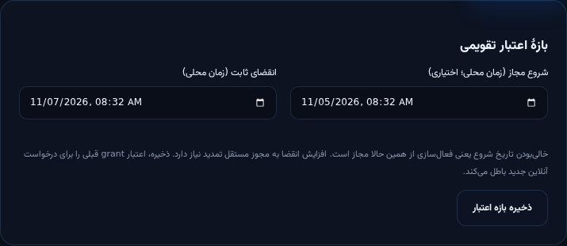
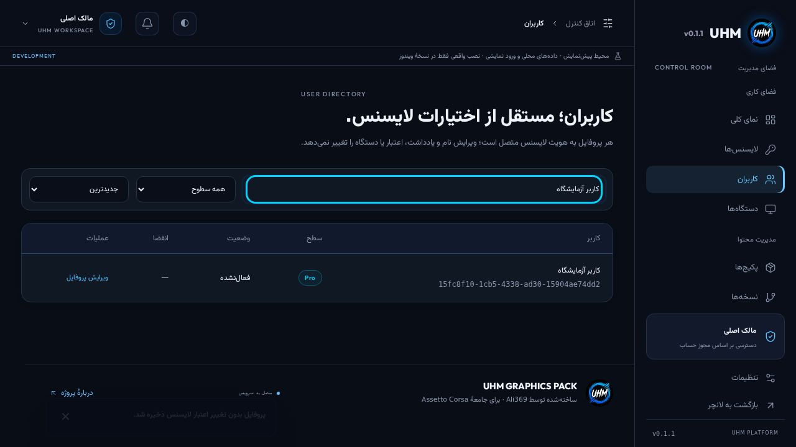
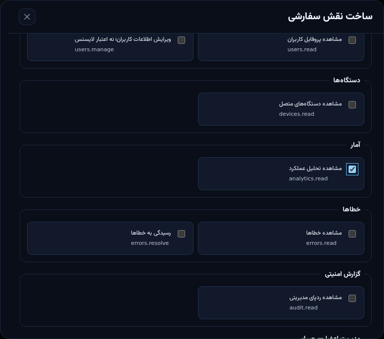
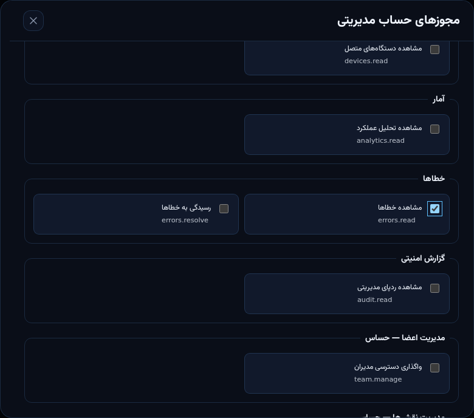
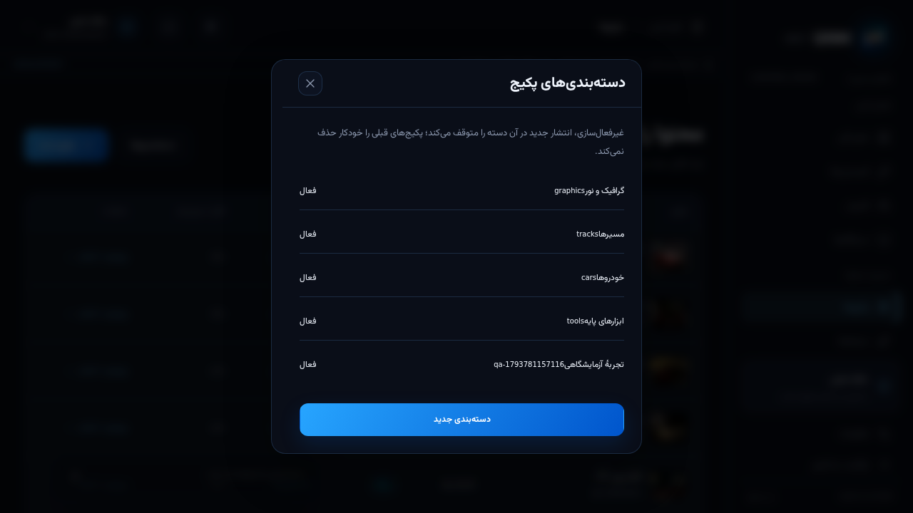
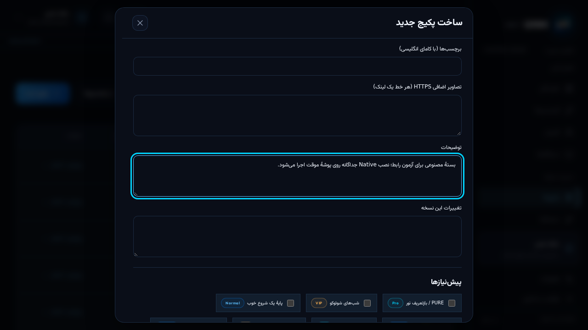
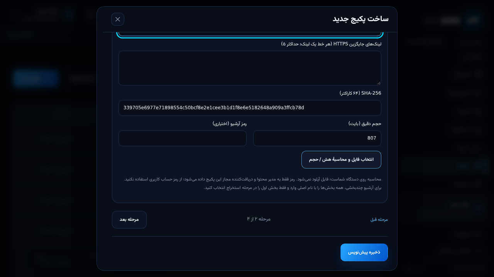
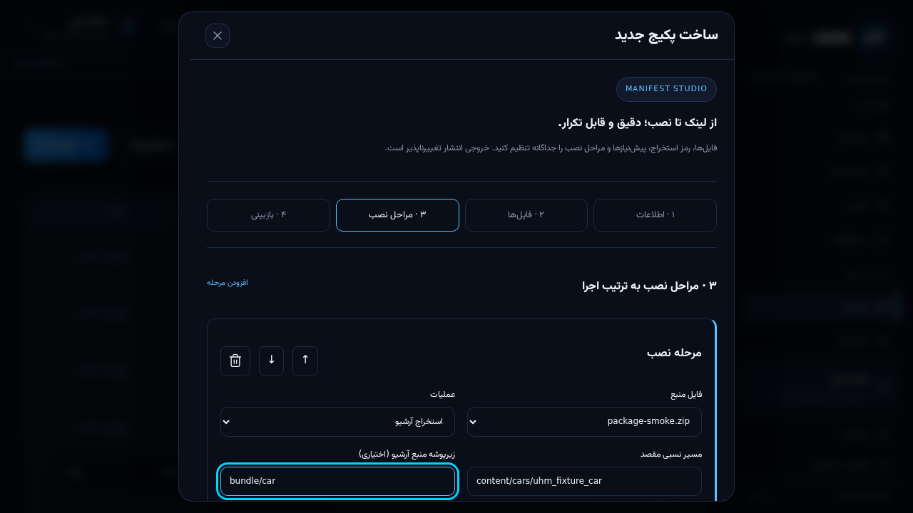
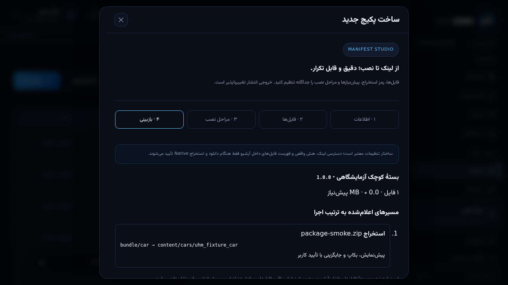

# راهنمای مدیریت UHM — ۱۵ بخش عملیاتی

**ویرایش ۲۰۲۶/۱۱/۰۴، مطابق سورس مرحلهٔ دوم مأموریت 0.1.2.**

این راهنما، گواه انتشار 0.1.2 نیست. نسخهٔ عمومی هنوز **0.1.1** است؛ امکانات جدیدِ زیر تا استقرار migrationها و API و ساخت نصاب جدید، الزاماً در تولید دیده نمی‌شوند. تصاویر، اسکرین‌شات واقعی رابط مشترک وب/دسکتاپ با API محلی و داده‌های جداشدهٔ آزمایشی‌اند؛ نه تصویر حساب Owner واقعی و نه تصویر نصب Native. پوشش آزمایش و موانع عرضه در [گزارش مأموریت](mission-0.1.2-progress-fa.md) ثبت می‌شود.

**اصل کار:** یک بازی، سه سطح Normal / Pro / VIP، یک دستگاه برای هر لایسنس؛ ورود اصلی فقط با کد لایسنس و اثبات کلید دستگاه. فایل بسته روی آپلودر مستقل شما می‌ماند؛ پنل، manifest، لینک و کنترل دسترسی را نگهداری می‌کند، نه میزبانی فایل حجیم.

## ۱. پیش‌نیاز و تشخیص محیط درست

1. از آدرس پنل مجاز پروژه وارد شوید؛ به strip بالای صفحه نگاه کنید. «محیط پیش‌نمایش» یعنی دادهٔ ایزوله و نصب واقعی ممنوع، نه تولید.
2. در محیط عملیاتی، اتصال API و هویت پروژه باید صحیح باشد. کلید عمومی برای راستی‌آزمایی است؛ هیچ private key، service-role secret یا کد کامل لایسنس نباید در مرورگر/راهنما/Git قرار گیرد.
3. Backend قابلیت‌های پشتیبانی‌شده را اعلام می‌کند. پنهان‌بودن نقش سفارشی، تاریخ تقویمی یا دسته‌بندی جدید، ممکن است به معنی قدیمی‌بودن سرور باشد؛ دکمه را با DevTools فعال نکنید.
4. برای آزمون نصب، فقط یک پوشه/پروفایل آزمایشی کاملاً جدا انتخاب کنید. هرگز با لایسنس Owner فعال، دادهٔ واقعی کاربران یا پوشهٔ اصلی Assetto Corsa تست نکنید.

**معیار موفقیت:** رابط بدون خطای startup باز می‌شود، محیط معلوم است و مجوزهای همان حساب نمایش داده می‌شوند. صفحهٔ سفید را با پاک‌کردن لایسنس یا نصب مجدد بازی «رفع» نکنید؛ نسخهٔ build و خطای console/request ID را ثبت کنید.

## ۲. ورود مدیر با لایسنس و دستگاه

1. Owner برای همکار یک لایسنس جدا صادر و در «تیم و دسترسی‌ها» به همان شناسه مجوز می‌دهد.
2. همکار کد را روی دستگاه خودش فعال می‌کند؛ ورود پنل با «ورود با لایسنس این دستگاه» انجام می‌شود.
3. Backend اعتبار لایسنس، دستگاه، entitlement و دسترسی فعلی را بررسی می‌کند. توکن پنل کوتاه‌مدت است؛ تغییر نقش در درخواست بعدی اعمال می‌شود، نه فقط بعد از خروج کاربر.
4. تعویض کامپیوتر به آزادسازی مجاز دستگاه نیاز دارد. گرفتن عکس کد یا انتقال کلید خصوصی دستگاه راه‌حل تعویض دستگاه نیست.

کد کامل فقط هنگام صدور دیده می‌شود. گم‌شدن کد، مجوز استخراج hash یا بازسازی کلید امضای اصلی نیست. هیچ حساب ایمیل/رمز جداگانهٔ اجباری برای مدیران عادی ساخته نمی‌شود.

## ۳. شناخت داشبورد و وضعیت‌ها

- **لایسنس‌ها:** صدور، پرونده، اعتبار، سطح و تاریخچه؛ نمایش و هر تغییر مجوز جدا دارد.
- **کاربران:** نام نمایشی، یادداشت داخلی و برچسب‌ها، بدون اختیار ضمنی تمدید یا reset.
- **دستگاه‌ها:** اتصال بر اساس کلید دستگاه، نه حدس‌زدن از IP.
- **پکیج‌ها / نسخه‌ها:** پیش‌نویس و انتشار تغییرناپذیر؛ فایل نصب‌شدهٔ کاربر با ویرایش پنل عوض نمی‌شود.
- **تحلیل، خطاها، رویدادها، تیم و کنترل سرویس:** داده/عملیات فقط طبق مجوز Backend.

«فعال‌نشده» با «فعال» فرق دارد؛ «شروع در آینده» قبل از starts_at و «منقضی» بعد از expires_at است. تعلیق/لغو بر نمایش اعتبار اولویت دارد. آرشیو، بایگانی مدیریتی است و با حذف دائمی سابقه یکی نیست. اعداد داشبورد از دادهٔ ثبت‌شده می‌آیند؛ گزارش‌نشدن رویداد، اثبات موفقیت نصب نیست.

## ۴. صدور Normal، Pro و VIP

1. «لایسنس‌ها → تولید لایسنس» را باز کنید.
2. سطح، تعداد و مدت را وارد کنید؛ نمونهٔ امن آزمایشگاهی: **Normal، یک کد، یک روز**.
3. بدون تاریخ ثابت، مدت از اولین فعال‌سازی شروع می‌شود. برای بازهٔ مشخص، شروع مجاز و انقضای ثابت را با دقت وارد کنید؛ فرم زمان محلی را به UTC تبدیل می‌کند.
4. شروع باید پیش از انقضا باشد. تاریخ ثابت بعد از فعال‌سازی عقب نمی‌رود تا کاربر مدت تازه‌ای بگیرد.
5. کد را یک‌بار از خروجی کپی و خصوصی تحویل دهید. در اسکرین‌شات عمومی و گزارش خطا قرار ندهید.



**کنترل:** لایسنس در فهرست با وضعیت فعال‌نشده/شروع آینده دیده شود؛ فعال‌سازی زودهنگام و اتصال دستگاه دوم باید رد شوند. یک VIP اجازهٔ تمام سطوح پایین‌تر دارد، اما نقش مدیریتی از tier اشتراک نتیجه نمی‌شود.

## ۵. ویرایش، تمدید، تعلیق، لغو و بایگانی

1. شناسه/پیشوند/نام/برچسب را جست‌وجو و پرونده را باز کنید؛ پیش از تغییر، شناسه و دستگاه را تطبیق دهید.
2. مشخصات داخلی، سطح، تاریخ و تمدید مستقل‌اند. ویرایش بازه‌ای که انقضا را زیاد می‌کند، علاوه بر ویرایش به `licenses.extend` نیاز دارد.
3. برای توقف موقت «تعلیق» و سپس «ازسرگیری»؛ برای لغو اعتبار «لغو» را استفاده کنید. لغو، معادل حذف ردیف و پاک‌کردن audit نیست.
4. بایگانی برای خارج‌کردن مورد از کار روزمره است. قبل از هر عملیات حساس متن تأیید را بخوانید؛ تغییر حساب مدیریتی خود یا مدیر قوی‌تر محدود می‌شود.
5. خطای تداخل ویرایش یعنی دیگری revision را عوض کرده است؛ صفحه را تازه و تغییرات را مقایسه کنید. ذخیرهٔ کورِ فرم قدیمی راه‌حل نیست.

**محدودیت آفلاین:** لغو آنلاین نمی‌تواند مجوزی را که پیش‌تر برای حداکثر بازهٔ آفلاین صادر شده، لحظه‌ای از کامپیوتر قطع‌شده پاک کند. هیچ ادعای «غیرقابل‌شکستن» یا TPM اجباری وجود ندارد.

## ۶. کاربران و حریم اطلاعات پروفایل

1. «کاربران» را باز کنید؛ نام، UUID یا برچسب را جست‌وجو کنید. فیلتر سطح و مرتب‌سازی نام/جدیدترین/انقضا مستقل است.
2. «ویرایش پروفایل» فقط نام، یادداشت و برچسب را تغییر می‌دهد. برای مثال «کاربر آزمایشگاه» با `qa, isolated`؛ اطلاعات واقعی شخص را در fixture نگذارید.
3. ذخیره را انجام دهید و نتیجه را دوباره جست‌وجو کنید. tier، زمان انقضا و اتصال دستگاه نباید به‌واسطهٔ این فرم عوض شوند.
4. `users.read` فقط خواندن است؛ `users.manage` به‌تنهایی فهرست را باز نمی‌کند. مدیر write-only فرم «ویرایش با شناسهٔ دقیق» دارد؛ چون اطلاعات فعلی دریافت نمی‌شود، مقادیر فرم **جایگزین** نام/یادداشت/برچسب قبلی می‌شوند.



API فهرست کاربران، hash کد و اثر انگشت دستگاه را در پاسخ این مجوز قرار نمی‌دهد. یادداشت داخلی را محل ذخیرهٔ رمز آرشیو یا کد کامل لایسنس نکنید.

## ۷. اتصال یک‌دستگاهی و آزادسازی امن

1. برای مشاهدهٔ رجیستری، مجوز `devices.read` لازم است؛ در API قدیمی، رابط از مسیر سازگارِ `licenses.read` استفاده می‌کند.
2. پیش از آزادسازی، از مالک لایسنس هویت و علت تعویض دستگاه را بپرسید. شناسهٔ دستگاه را از روی IP حدس نزنید.
3. مشاهدهٔ دستگاه، اختیار reset نیست. آزادسازی به `licenses.reset` و تأیید حساس نیاز دارد؛ حساب خود و مدیر قوی‌تر حفاظت می‌شوند.
4. پس از reset، دستگاه قبلی در تمدید/نصب آنلاین بعدی دیگر معتبر نیست. دستگاه جدید باید جریان فعال‌سازی و اثبات کلید را بگذراند.
5. audit عملیات را بررسی کنید. کلید دستگاه قبلی را به دستگاه جدید کپی نکنید و برای رفع مشکل، کلید امضای لایسنس یا updater را نچرخانید.

**کنترل مجوز:** دارندهٔ فقط `devices.read` نباید نام/یادداشت خصوصی پروفایل، کد لایسنس یا اختیار تمدید/لغو بگیرد.

## ۸. تیم، نقش سفارشی و ۲۶ مجوز مستقل

1. در «تیم و دسترسی‌ها → ساخت نقش»، نام روشن، توضیح کوتاه و حداقل مجوز لازم را انتخاب کنید.
2. نمونهٔ بازبین: `content.read` + `analytics.read`؛ نه publish و نه دیدن رمز فایل.
3. یک یا چند نقش فعال به شناسهٔ لایسنس همکار بدهید؛ مجوز مستقیم، مستقل از نقش‌های انتخاب‌شده جمع می‌شود.
4. غیرفعال‌سازی نقش فقط مجوزهای همان نقش را برمی‌دارد؛ مجوز مستقیم و نقش دیگر باقی می‌مانند. پس از تغییر اثرگذار، تأیید و audit را بررسی کنید.
5. مدیر غیرمالک نمی‌تواند از طریق نقش واسطه اختیاری بالاتر از خودش واگذار کند. آخرین Owner حفاظت می‌شود.





| گروه | مجوزهای مستقل |
| --- | --- |
| لایسنس | `licenses.read/create/update/extend/suspend/revoke/reset/archive` |
| کاربران و دستگاه | `users.read`، `users.manage`، `devices.read` |
| محتوا | `content.read/create/update/publish/delete/versions`، `categories.manage` |
| مشاهده و رسیدگی | `analytics.read`، `errors.read`، `errors.resolve`، `audit.read` |
| حساس | `team.manage`، `roles.manage`، `service.manage` |
| سازگاری قدیمی | `content.write`؛ معادل ساخت/ویرایش قدیمی، نه انتشار/حذف/بازگردانی |

«Owner» همهٔ مجوزها را دارد. قالب نقش به‌تنهایی نباید مجوزِ لغوشده را دوباره بسازد. پنهان‌کردن دکمه، جای کنترل API نیست؛ درخواست مستقیم غیرمجاز هم باید 403 بگیرد.

## ۹. دسته‌بندی، اطلاعات و کاور پکیج

1. «پکیج‌ها → دسته‌بندی‌ها» را با `categories.manage` باز کنید؛ شناسهٔ انگلیسی ثابت و نام نمایشی بسازید.
2. غیرفعال‌کردن دسته، انتشار جدید را متوقف می‌کند؛ نسخهٔ قبلی کاربران را خودکار حذف نمی‌کند. تغییر نام به rebuild لانچر نیاز ندارد.
3. «پکیج جدید → ۱ · اطلاعات»: نام، slug، نسخهٔ سه‌قسمتی، tier، دسته و توضیح را وارد کنید. نامشخص را حدس نزنید؛ author/brand خالی بهتر از اطلاعات ساختگی است.
4. نوع محتوا، سازنده، برند، tags، تصویر اصلی/تصاویر اضافی، changelog و پیش‌نیازها را ثبت کنید. تصویر باید HTTPS عمومی یا تصویر داخلی مجاز باشد؛ URL صفحهٔ ورود، عکس دانلود مستقیم نیست.
5. `test` از کاتالوگ عمومی پنهان است. زمان‌بندی انتشار، با منطقهٔ زمانی مدیر کنترل شود؛ snapshot قبلی تا موعد/شرایط مناسب در دسترس می‌ماند.





## ۱۰. فایل‌ها، mirror، حجم، هش و رمز آرشیو

1. «۲ · فایل‌ها → افزودن فایل»: نام واقعی فایل، نوع ZIP/RAR/7z/file/EXE و لینک مستقیم HTTPS را وارد کنید.
2. فایل باینری روی آپلودر مستقل خودتان می‌ماند. لینک صفحهٔ تبلیغ/کپچا/کوکی‌دار یا موقتِ منقضی‌شونده، دانلود قابل‌اتکا نیست. محدودیت حجم، نگهداری و دانلود رایگان آپلودر را واقعاً بررسی کنید.
3. «انتخاب فایل و محاسبهٔ هش / حجم» فقط فایل انتخابی را محلی می‌خواند؛ آپلود نمی‌کند. مرورگر تا ۳۲ MiB محدود است؛ Native برای فایل بزرگ جریانی می‌خواند. گزینهٔ مستقل ویندوز:

   ```powershell
   (Get-FileHash -Algorithm SHA256 .\package.zip).Hash.ToLower()
   (Get-Item .\package.zip).Length
   ```

4. SHA-256 باید دقیقاً ۶۴ رقم هگز کوچک و حجم، تعداد **بایت** واقعی باشد. تغییر یک بایت فایل نیازمند هش/حجم تازه و نسخهٔ انتشار جدید است.
5. mirrorها باید همان بایت‌ها را بدهند؛ بیش از پنج لینک جایگزین برای هر فایل پذیرفته نمی‌شود. ترتیب فایل‌ها را با کنترل بالا/پایین مرتب کنید.
6. رمز آرشیو اختیاری و حساس است؛ رمز حساب کاربری را اینجا نگذارید. همهٔ بخش‌های آرشیو چندقسمتی را با نام اصلی اضافه کنید؛ مرحلهٔ extract فقط قسمت اول را انتخاب کند.



فایل EXE خودکار اجرا نمی‌شود. اعتبار لینک در فرم، تضمین سالم‌بودن میزبان یا محتویات آرشیو نیست؛ Native حجم، هش، DNS/redirect و استخراج ایمن را هنگام عملیات بررسی می‌کند.

## ۱۱. مراحل نصب، تغییر نام و پیش‌نیاز

1. «۳ · مراحل نصب» را باز کنید؛ هر مرحله یک فایل منبع، action، مقصد نسبی و سیاست تداخل دارد.
2. برای extract، زیرپوشهٔ منبع را بدون `/` ابتدایی وارد کنید؛ مثال: `bundle/car`.
3. مقصد مستقل مانند `content/cars/uhm_fixture_car`، پوشهٔ انتخابی را با نام دلخواه در جای درست می‌نشاند. مقصد نسبت به ریشهٔ بازی است؛ مسیر مطلق، `..`، `.uhm`، reparse/symlink و نام رزروشده مجاز نیست.
4. برای copy، فایل مستقیم و نام/مسیر مقصد را مشخص کنید. ZIP/RAR/7z را برای استخراج با action درست انتخاب کنید.
5. مراحل را اضافه/حذف/مرتب کنید؛ depends_on باید فقط به مرحلهٔ بالاترِ موجود اشاره کند. حذف یک فایل، مراحل وابستهٔ همان فایل را هم حذف می‌کند؛ قبل از ذخیره دوباره مرور کنید.
6. پیش‌نیاز پکیج باید منتشر و برای tier این بسته قابل دریافت باشد. cycle، وابستگی ناموجود، مرحلهٔ ناشناخته و بیش از ۳۰ پکیج در plan رد می‌شوند.



برای فایل شخصی، پیش‌فرض امن «توقف در تداخل» است. «بکاپ و جایگزینی» هم بدون پیش‌نمایش واقعی و تأیید نصب اجرا نمی‌شود. سؤال سیاست rollback فایل شخصی بدون پاسخ رد شده است؛ هیچ مجوزی برای overwrite خودکار استنباط نشده است.

## ۱۲. بازبینی، ذخیره، آزمون و انتشار

1. «۴ · بازبینی» را باز کنید. خطاهای قرارداد و پیش‌نیاز را اصلاح و مجموع فایل/حجم/مسیر را بررسی کنید.
2. این نما فقط **مسیر اعلام‌شده** است، نه فهرست حدس‌زدهٔ داخل آرشیو. درخت واقعی پس از استخراج Native و قبل از تغییر بازی ساخته می‌شود.
3. «ذخیره پیش‌نویس» و سپس بازکردن مجدد: revision و فایل‌های ذخیره‌شده را کنترل کنید. پیش‌نویس معتبرِ بدون فایل ممکن است ذخیره شود، اما قابل انتشار نیست.
4. «اعتبارسنجی سرور» روی نسخهٔ **ذخیره‌شده** کار می‌کند. تغییرات ذخیره‌نشدهٔ فرم، به‌صورت پنهانی منتشر نمی‌شوند.
5. «نصب تست روی این دستگاه» فقط در Native، با لایسنس معتبر همان دستگاه و پس از انتخاب مسیر آزمایشی مناسب انجام می‌شود. قبل از هر اعمال، preview واقعی را بخوانید؛ لغو preview باید نصب را متوقف کند.
6. پس از آزمون، «انتشار نسخه» و تأیید را بزنید. snapshot منتشرشده تغییرناپذیر است؛ ویرایش بعدی، نسخهٔ تازه می‌خواهد.



**fixture پروژه:** `tests/fixtures/package-smoke.zip`، حجم 807 bytes، SHA-256 `339705e6977e71898554c50bcf8e2e1cee3b1d1f8e6e5182648a909a3ffcb78d`. این فقط چند فایل metadata/config مصنوعی دارد و خودرو قابل‌راندن نیست؛ پوشهٔ خارج از `bundle/car` نباید نصب شود. اسکریپت `package-chain-smoke.ts` از دیتابیس و کلیدهای یک‌بارمصرف استفاده می‌کند؛ آزمون Native جداگانه در Windows CI لازم است. نتیجهٔ مرورگر را به‌جای نصب واقعی گزارش نکنید.

## ۱۳. نسخهٔ جدید، بازگردانی snapshot و حذف منطقی

1. برای ویرایش انتشار فعلی، شمارهٔ بالاتر انتخاب و پیش‌نویس تازه بسازید؛ نسخهٔ قبلی تا انتشار تازه در کاتالوگ باقی می‌ماند، مگر عمداً بایگانی شود.
2. «نسخه‌ها → جزئیات انتشار → ساخت پیش‌نویس از این نسخه» با `content.versions`، manifest قدیمی را با شمارهٔ **جدیدتر** برمی‌گرداند. این عملیات، فایل کاربران را downgrade نمی‌کند.
3. `content.delete` فقط حذف منطقی از کاتالوگ است: slug را دقیق تأیید کنید. audit و release history باقی می‌مانند؛ نصب موجود کاربران حذف نمی‌شود.
4. حذف بسته‌ای که snapshot زندهٔ دیگری به آن وابسته است رد می‌شود. ابتدا وابستگی‌ها و انتشار جانشین را هماهنگ کنید؛ پاک‌کردن رکورد دیتابیس میان‌بر مجاز نیست.
5. تداخل revision را با refresh/مقایسه حل کنید، نه تکرار کور. rollback فیزیکی فایل‌ها جریان جدا دارد؛ بازیابی crash journal، مجوز overwrite فایل شخصی بعد از نصب نیست.

## ۱۴. دانلود، کتابخانه، خطا و عملیات آفلاین

- **دانلود:** Native لینک اصلی و سپس mirror را امتحان می‌کند؛ هش/اندازهٔ غلط نباید فایل نصب‌شده تولید کند. pause/resume در انتقال و cancel در مرحلهٔ مجاز انجام می‌شود؛ اعمال تراکنشی را با kill دستی قطع نکنید.
- **کمبود فضا/قطع شبکه:** فضای staging، بکاپ و cache لازم است. بعد از اتصال، خطای دقیق را بررسی کنید؛ فایل ناتمام را به‌عنوان نصب موفق علامت نزنید.
- **کتابخانه:** scan، محتوای دستی/Content Manager و متعلق به لانچر را تفکیک می‌کند؛ metadata خوانده‌نشده «نامشخص» است. شمارش presence-only کتابخانه، اثبات SHA تمام فایل‌ها نیست.
- **حذف محتوای محلی:** فایل‌ها را در preview انتخاب کنید؛ برای محتوای خارجی هشدار و تأیید جدا لازم است. quarantine/بازیابی را با حذف کاتالوگ اشتباه نگیرید.
- **آفلاین:** رویدادها در outbox پایدار صف می‌شوند و فقط موارد تأییدشدهٔ سرور پاک می‌شوند. refresh اشتراک بعد از اتصال ضروری است؛ UI آفلاین نباید نصب ساختگی نمایش دهد.
- **خطاها/رویدادها:** request ID، شناسهٔ بسته/نسخه، زمان و وضعیت را ثبت کنید؛ کد لایسنس، توکن، URL امضاشده و رمز آرشیو را گزارش نکنید. `errors.read` و `errors.resolve` مستقل‌اند.

پیام `EDIT_CONFLICT`: فرم قدیمی؛ `CATEGORY_UNAVAILABLE`: دستهٔ غیرفعال/ناموجود؛ `PACKAGE_IN_USE`: وابستگی زنده؛ `RELEASE_IMMUTABLE`: شمارهٔ تازه لازم؛ `DEPENDENCY_UNAVAILABLE`: پیش‌نیاز منتشر/دردسترس نیست؛ `TIER_REQUIRED`: سطح کافی نیست. اگر خطای ناشناخته بود، با دادهٔ واقعی تولید آزمایش نکنید.

## ۱۵. آپدیت لانچر، بازیابی و چک‌لیست عرضه

بسته/لینک/tier/نسخهٔ محتوا معمولاً rebuild لانچر نمی‌خواهد؛ تغییر کد Native یا رابطِ نصاب‌شده نیازمند release لانچر است.

1. منبع رسمی updater و کلید عمومی ثابت حفظ می‌شود؛ کلید امضای updater از لایسنس مستقل است. هیچ private key تازه‌ای را به مخزن/چت نیاورید.
2. سیاست برنامه: بررسی startup و دوره‌ای، دانلود محدود و بررسی امضا در پس‌زمینه؛ نصب خودکار فقط خروج امن/اجرای بعدی، بدون قطع بازی یا عملیات نصب جاری.
3. گزینهٔ بررسی خودکار و بررسی دستی مستقل‌اند. خاموش‌کردن بررسی، آپدیت آماده/دانلود درحال اجرا را الزاماً لغو نمی‌کند.
4. قبل از عرضه، fresh install، ارتقای **نصاب عمومی واقعی 0.1.1**، حفظ تنظیمات/لایسنس/فایل، امضای دست‌کاری‌شده، شکست نصب و بازیابی باید تأیید شوند. fixture قدیمی 0.0.0 جای این معیار نیست.
5. تا قبولی، نسخه و feed نباید 0.1.2 اعلام شوند. بعد از قبولی: bump هماهنگ npm/lock/Cargo/Tauri، CI Windows، امضا، artifact/checksum/feed، دانلود دوباره و بررسی عمومی، و سپس گزارش نهایی.

**وضعیت این راهنما:** رابط‌ها و آزمون‌های backend/browser جدید وجود دارند؛ وضعیت نهایی Native/upgrade/deploy/release فقط از [گزارش مأموریت](mission-0.1.2-progress-fa.md) و run همان commit خوانده شود. فعلاً این متن نباید به‌عنوان اعلام «نسخهٔ 0.1.2 آماده است» بازنشر شود.
