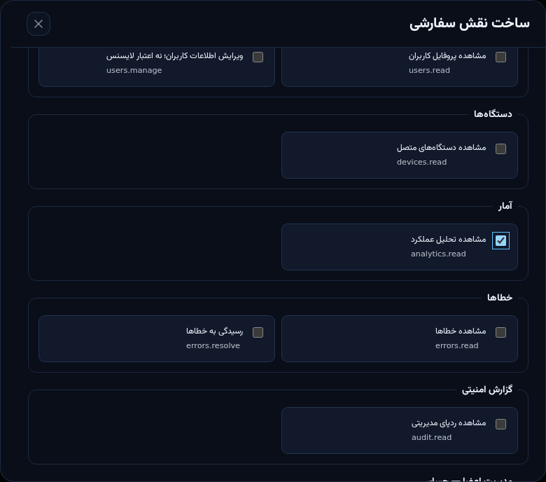
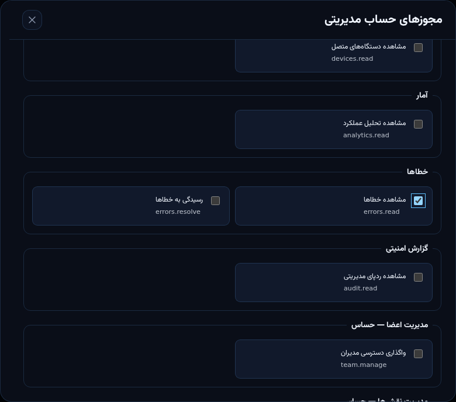
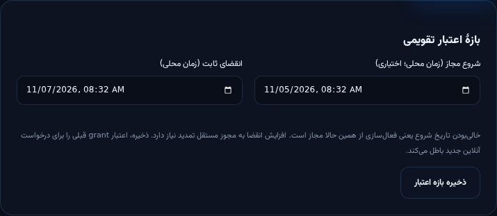

# راهنمای نقش‌های مستقل و تاریخ اعتبار

**دامنهٔ این راهنما:** قابلیت‌های تکمیل‌شدهٔ مرحلهٔ نخست مأموریت 0.1.2؛ نه راهنمای نهایی تمام Package Manager. فعلاً این قابلیت‌ها در سورس و محیط ایزوله تست شده‌اند؛ API تولید نسخهٔ ۱۰ است و migrationهای جدید هنوز deploy نشده‌اند. اگر دکمهٔ نقش سفارشی یا تاریخ تقویمی دیده نمی‌شود، Backend آن قابلیت را اعلام نکرده است؛ رابط برای جلوگیری از عملیات نامعتبر آن را پنهان می‌کند.

## ۱. ورود مدیر

ورود اصلی همان لایسنس و کلید دستگاه است. ابتدا مالک باید از **لایسنس‌ها** کد بدهد و در **تیم و دسترسی‌ها** به همان لایسنس مجوز مدیریت اختصاص بدهد. دریافت‌کننده کد را روی دستگاه خودش فعال می‌کند. هیچ کلید خصوصی دستگاه یا کد کامل لایسنس را در تصویر، گزارش عمومی یا گروه تیم قرار ندهید.

- هر لایسنس یک دستگاه فعال دارد. مدیر حساب ایمیل/رمز جداگانهٔ اجباری ندارد.
- توکن مدیریتی ۱۵دقیقه‌ای است؛ اعتبار لایسنس/دستگاه/entitlement و دسترسی فعلی در Backend کنترل می‌شود.
- مدیر نمی‌تواند از رابط، حساب مدیریتی خودش را تغییر دهد؛ تغییر حساب مدیر دیگر به مالک/مجوزهای کافی نیاز دارد.

## ۲. ساخت نقش قابل استفادهٔ مجدد

پس از استقرار قابلیت:

1. **تیم و دسترسی‌ها → نقش‌های سفارشی → ساخت نقش** را باز کنید.
2. نام کوتاه و توضیح کاربرد بنویسید؛ مثلاً «بازبین گزارش».
3. فقط `licenses.read` و `analytics.read` را انتخاب کنید. این نمونه حق صدور، تمدید یا تغییر پکیج نمی‌دهد.
4. فعال‌بودن نقش را بررسی کنید؛ **ذخیره نقش** و تأیید اثر بر اعضا را بزنید.
5. نقش در فهرست قابل ویرایش است. نقش‌های هم‌نام یا فرم قدیمی که revision آن تغییر کرده، رد می‌شوند؛ صفحه را تازه و تغییرات را دوباره بررسی کنید.

نام فنی هر مجوز زیر توضیح آن است. گروه‌های «مدیریت اعضا»، «مدیریت نقش‌ها» و «تنظیمات سیستم» حساس‌اند؛ صرفاً برای مشاهدهٔ آمار به آن‌ها نیاز ندارید.

## ۳. اختصاص چند نقش و مجوز مستقیم

1. یک لایسنس معتبر و غیرلغوشده بسازید.
2. **واگذاری دسترسی جدید** را باز و همان لایسنس را انتخاب کنید.
3. قالب نقش، نقطهٔ شروع چک‌باکس‌های مستقیم است؛ آن‌ها را دقیق مرور کنید. Owner استثنائاً همهٔ اختیارها را دارد، حتی اگر چک‌باکس مستقیم خالی باشد.
4. در بخش نقش‌های هم‌زمان، حداکثر هشت نقش را انتخاب کنید.
5. مجوزهای مستقیم را جدا تنظیم کنید. دسترسی نهایی = اجتماع مجوزهای مستقیم و نقش‌های فعال. عنوان «مشاهده‌گر» به‌تنهایی مجوز پنهان اضافه نمی‌کند.
6. ذخیره و تأیید کنید. تغییر عضویت، توکن قدیمی را با version قبلی نامعتبر می‌کند؛ فرد دوباره وارد می‌شود.

مثال تست‌شده: نقش اول مشاهدهٔ لایسنس/آمار، نقش دوم مشاهدهٔ محتوا و تنها مجوز مستقیم `errors.read`. این عضو حق صدور لایسنس یا انتشار محتوا ندارد.

### لغو دسترسی

- برای بستن دسترسی یک عضو، ویرایش عضو → خاموش‌کردن «دسترسی مدیریت فعال باشد» → ذخیره.
- برای حذف یک نقش از تمام اعضای دارای آن، خود نقش را غیرفعال کنید. **مجوزهای مستقیم و نقش‌های دیگر آن اعضا باقی می‌مانند.**
- تغییر تعریف نقش روی درخواست بعدی توکن قبلی نیز اعمال می‌شود؛ نیازی به صبر برای پایان ۱۵ دقیقه نیست.
- غیرفعال‌سازی مدیریت با لغو اشتراک بازی یکی نیست. برای قطع لایسنس از عملیات تعلیق/لغو لایسنس استفاده کنید.
- مهاجم با فرستادن `role_ids` دلخواه یا تغییر چک‌باکس‌های HTML مجوز نمی‌گیرد؛ API تعریف نقش و اختیار واگذارکننده را دوباره بررسی می‌کند.

## ۴. صدور با تاریخ تقویمی

در **لایسنس‌ها → تولید لایسنس**:

- Normal/Pro/VIP، تعداد و مدت روزانه را مشخص کنید.
- شروع مجاز اختیاری است: خالی یعنی فعال‌سازی اکنون مجاز است؛ تاریخ آینده یعنی فعال‌سازی قبل از آن رد می‌شود.
- انقضای تقویمی اختیاری است: خالی یعنی مدت از اولین فعال‌سازی محاسبه می‌شود؛ مقدار ثابت با فعال‌سازی جابه‌جا نمی‌شود.
- زمان‌ها در فرم، محلی‌اند و به ISO/UTC به API فرستاده می‌شوند. انقضا باید پس از شروع و هنگام صدور در آینده باشد.
- کد کامل تنها یک بار نمایش داده می‌شود. خروجی CSV را در محل خصوصی نگه دارید.

برای تغییر بازه، پروندهٔ لایسنس → **بازهٔ اعتبار تقویمی** را باز کنید. مجوز ویرایش لازم است؛ افزایش انقضا به مجوز مستقل تمدید هم نیاز دارد. انقضای لایسنس فعال را نمی‌توان به «بدون انقضا» تبدیل کرد.

تغییر بازه entitlement version را افزایش می‌دهد؛ درخواست آنلاین با grant قدیمی رد می‌شود. مجوز آفلاینِ از قبل صادرشده بلافاصله از دستگاه پاک نمی‌شود و همان سقف آفلاین قبلی را دارد.

## ۵. خطاهای رایج

| پیام/کد               | اقدام                                                                                  |
| --------------------- | -------------------------------------------------------------------------------------- |
| `EDIT_CONFLICT`       | مدیر دیگری فرم را ذخیره کرده؛ صفحه را تازه کنید و تغییر جدید را ببینید.                |
| `ROLE_DENIED`         | مجوز مستقیم یا نقش لازم ندارید، یا هدف مدیریتی بالاتر از اختیار شماست؛ مالک بررسی کند. |
| `ROLE_UNAVAILABLE`    | نقش انتخاب‌شده حذف/غیرفعال یا شناسه نامعتبر است؛ از گزینه‌های تازه انتخاب کنید.        |
| `ROLE_NAME_EXISTS`    | نام نقش را یکتا انتخاب کنید.                                                           |
| `SELF_ACCESS_CHANGE`  | حساب مدیریتی خود را نمی‌توانید از این مسیر تغییر دهید؛ مدیر مجاز دیگر اقدام کند.       |
| `LAST_OWNER`          | آخرین مالک را نمی‌توان حذف یا تنزل داد؛ ابتدا مالک دوم معتبر لازم است.                 |
| خطای اعتبارسنجی تاریخ | انقضا باید پس از شروع باشد؛ تاریخ انقضای صدور نباید گذشته باشد.                        |

## ۶. ردپای مدیریتی و امنیت

تغییر نقش/عضویت و بازهٔ اعتبار، با actor، زمان، هدف و before/after ثبت می‌شود. جدول‌های جدید RLS دارند؛ anon/authenticated حق خواندن جدول یا اجرای RPC ندارند. کلید service_role فقط سمت سرور باقی می‌ماند. Backend مرجع کنترل مجوز است، نه ظاهر صفحه.

[وضعیت کامل مأموریت و معیارهای باز انتشار](mission-0.1.2-progress-fa.md) · [راهنمای قبلی مدیریت و پکیج‌ها](admin-console-fa.md)
