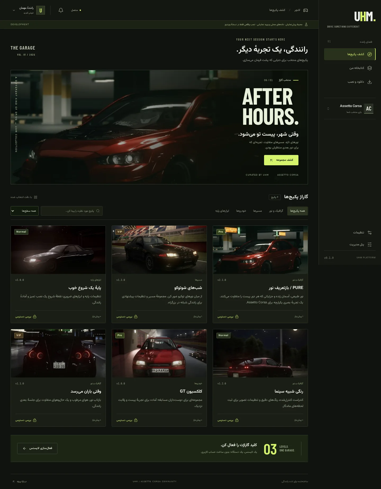
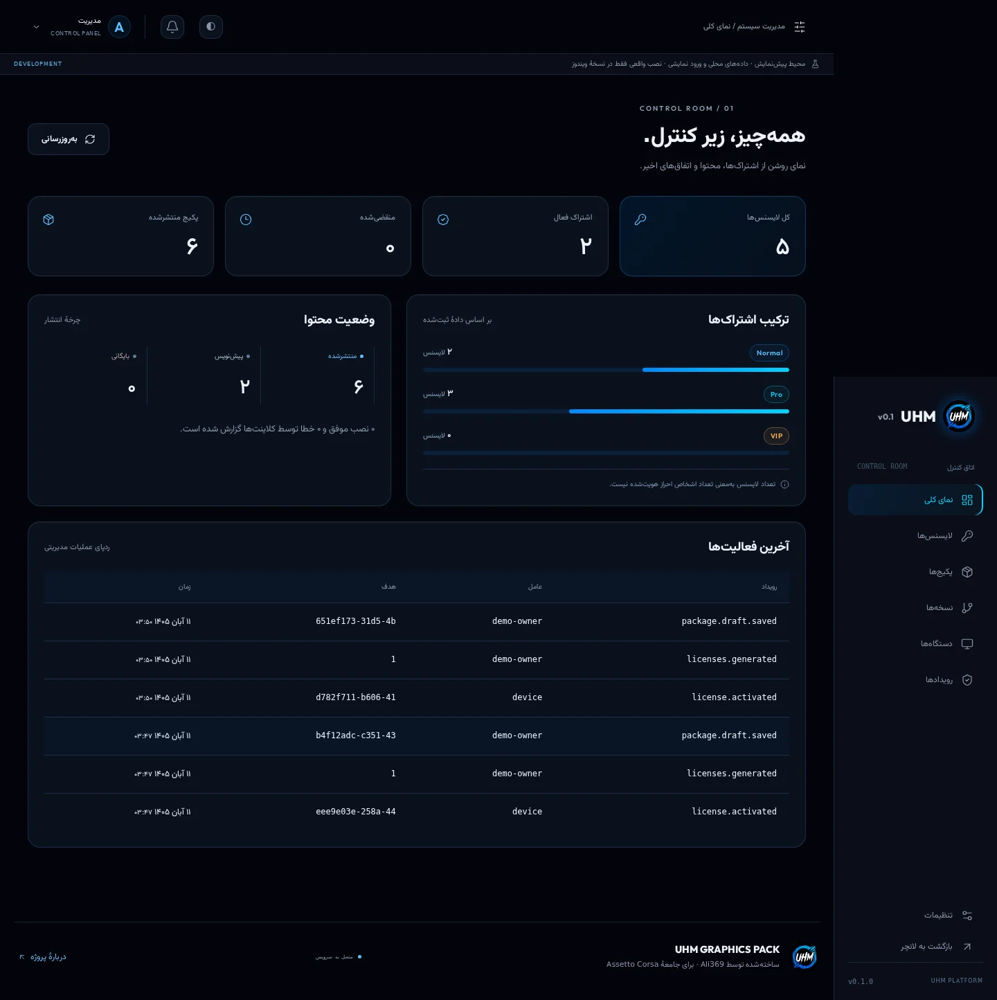

# تصمیم‌های طراحی UHM

## چه چیزهایی عمداً کنار گذاشته شد؟

- گرادیان بنفش/آبی، تیتر گرادیانی و ظاهر تکراری SaaS؛ هویت پروژه باید به رانندگی شبانه و جامعه Assetto Corsa مربوط باشد.
- آمار ساختگی، نمودار تصادفی و «نصب موفق» بدون تأیید موتور؛ داشبورد داده API را نشان می‌دهد و پیش‌نمایش مرورگر نصب را شبیه‌سازی نمی‌کند.
- گوشه‌های بیش‌ازحد گرد، کارت داخل کارت و فاصله‌های بی‌هدف؛ قاب‌های کم‌انحنا، خط‌های مشخص و تراکم متناسب با لانچر انتخاب شدند.
- فونت و تصویر خارجی در زمان اجرا؛ فونت‌های محلی و تصاویر موجود خود پروژه استفاده شدند.
- انیمیشن دائمی و `transition: all`؛ حرکت محدود است و تنظیم reduced-motion رعایت می‌شود.
- صفحه موبایل صرفاً کوچک‌شده دسکتاپ؛ چیدمان کارت، ناوبری پایین و منوی بخش‌ها جدا تنظیم شدند.

## نتیجه اجرایی

پالت زغالی/لیمویی، تایپوگرافی فارسی Vazirmatn و نمایش لاتین Barlow Condensed، تصاویر واقعی خودرو و محوریت «گاراژ پکیج‌ها». پنل مدیریت همان زبان بصری را با تراکم بیشتر و جدول‌های عملیاتی حفظ می‌کند. تصویرها از اجرای واقعی مرورگرند، نه mockup تولیدشده.

## منابع مطالعه اولیه

این‌ها نقدها و توصیه‌های طراحی‌اند، نه استاندارد امنیتی یا اثبات سلیقه عمومی:

- https://prg.sh/ramblings/Why-Your-AI-Keeps-Building-the-Same-Purple-Gradient-Website
- https://moelkholy1995.medium.com/beyond-make-it-beautiful-the-anti-slop-framework-for-ai-frontend-craftsmanship-c99bbee6c994
- https://www.reddit.com/r/ClaudeAI/comments/1s6mm8o/what_are_dead_giveaways_for_ai_slop_websites/

دسترسی‌پذیری و کیفیت بصری به تست انسانی بیشتری نیاز دارند؛ صرف اجرای خودکار مرورگر، معادل ممیزی کامل WCAG نیست.
