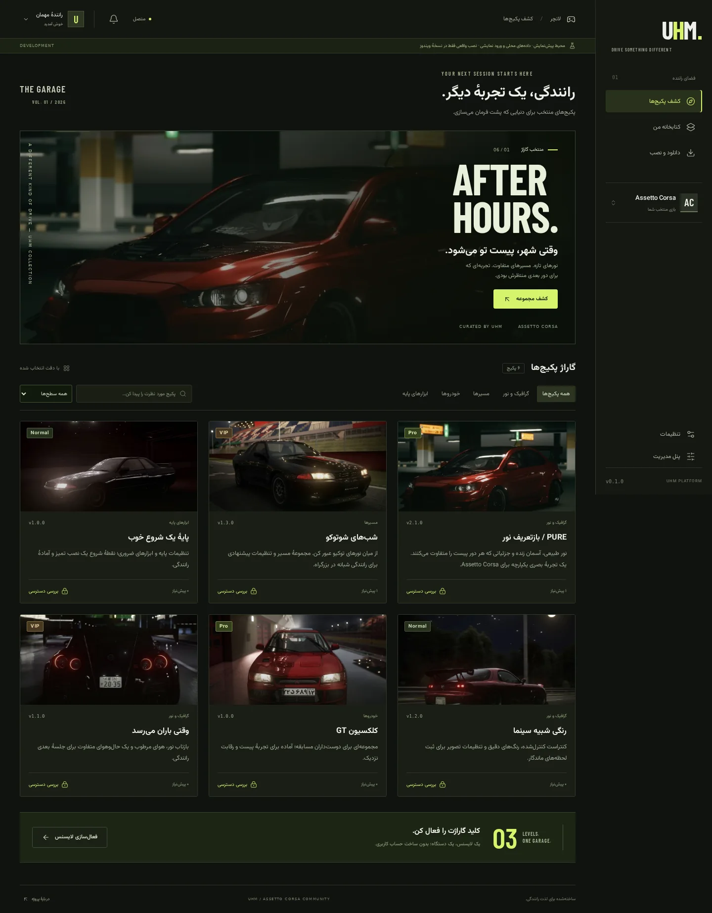
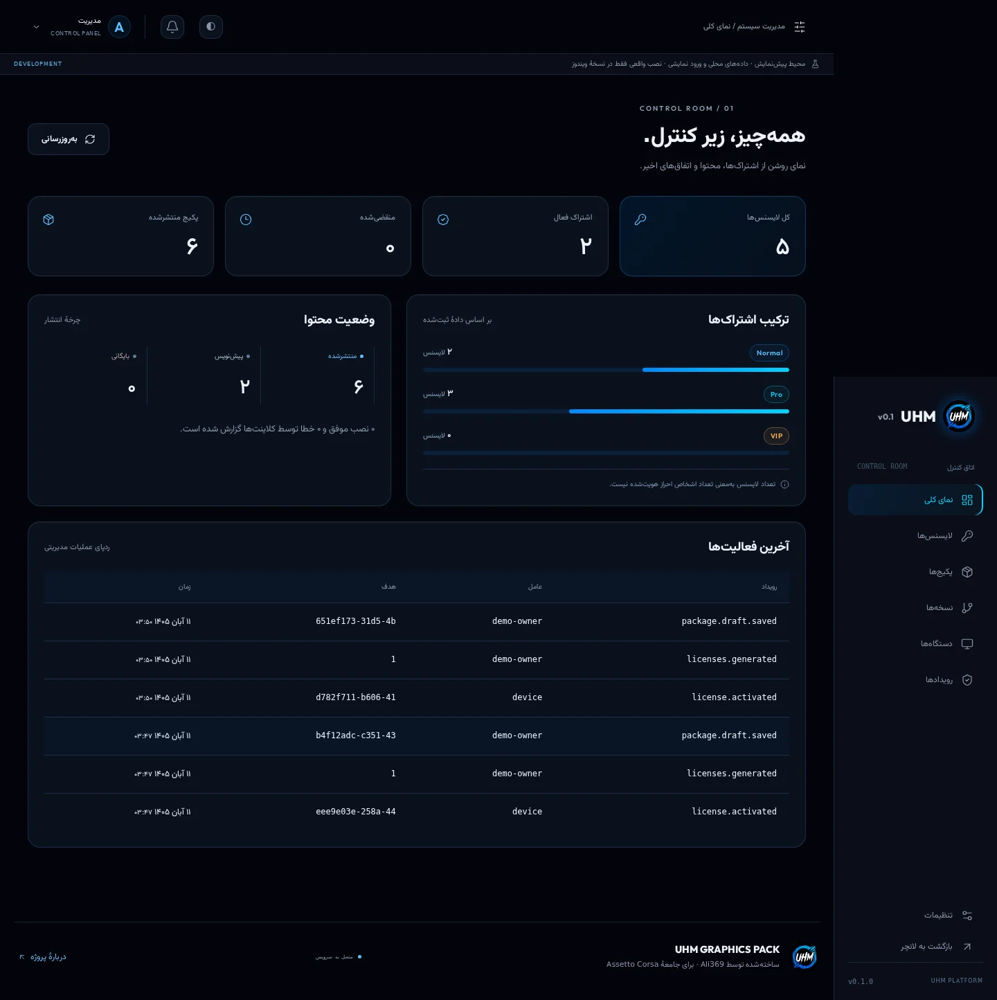

# بازطراحی لانچر براساس سایت اصلی UHM

## مرجع واقعی و نسخه مورد استفاده

- سایت درخواستی: https://aliam664.github.io/Uhm/
- مخزن: https://github.com/aliam664/Uhm
- شاخه منتشرشده در GitHub Pages: `arena/019fe854-uhm`، نه `main`.
- commit مرجع: `88414f9b1507c003bc7a9a25de4636ef716683c6`.

طبق درخواست صریح مالک، کد CSS و assetهای همان پروژه استفاده شده‌اند؛ صرفاً از روی تصویر یک تم مشابه حدس زده نشده است. این تصمیم جایگزین طرح قبلی زغالی–لیمویی لانچر شد.

## موارد منتقل‌شده از سورس

- رنگ زمینه `#03050a`، آبی `#0088ff`، آبی روشن `#5ec0ff` و فیروزه‌ای `#00d4ff`.
- فونت‌های variable اصلی **UHM Vazirmatn** و **UHM Outfit** به‌صورت محلی؛ مجوزهای OFL حفظ شده‌اند.
- لوگوی واقعی، تصویر قاب مورب خودرو، نه تصویر تولیدشده، و ویدیوی اصلی Showcase.
- هدر افقی با لوگوی درخشان، هیروی دو ستونه با تیتر «گرافیک استو را یک سطح بالاتر ببر»، دکمه‌های آبی گرادیانی، نوار ticker، قاب ویدیو و گالری تصاویر.
- کارت‌های نیمه‌شفاف، حاشیه‌های آبی، radiusهای ۱۲/۱۸/۲۴، خطوط پس‌زمینه، حرکت قاب تصویر و حالت reduced-motion.
- منوی کشویی سمت چپ، تم روشن/تیره با ذخیره ترجیح و طراحی موبایل.
- آیکن ویندوز و favicon نیز از لوگوی همین سایت ساخته شده‌اند.

سه فایل `style.css`، `design-polish.css` و `professional-home.css` مرجع در `apps/web/src/reference.css` با scope مربوط به صفحه اصلی منتقل شده‌اند تا فرم‌ها و جدول‌های عملیاتی را ناخواسته تغییر ندهند. `brand-theme.css` همان tokenها و زبان بصری را به کتابخانه، صف نصب، دیالوگ‌ها، تنظیمات و پنل مدیریت می‌برد.

## تفاوت‌های آگاهانه با سایت بازاریابی

این پروژه همچنان **لانچر** است، نه یک کپی غیرعملیاتی از سایت آموزشی:

- منوی هدر به کاتالوگ، کتابخانه، دانلود و تنظیمات متصل است.
- CTAها به کاتالوگ، نمایش ویدیو، انتخاب مسیر و فعال‌سازی واقعی API متصل‌اند.
- اعداد کاتالوگ از API می‌آیند؛ آمار آموزشی ثابت سایت به‌عنوان آمار لانچر استفاده نشده است.
- اطلاعات محیط نمایشی همچنان مشخص است؛ نصب مرورگری جعل نمی‌شود.
- دانلود مستقیم RAR سایت، جایگزین کنترل مجوز، hash و موتور نصب نشده است.
- سایت مرجع پنل مدیریت ندارد؛ پنل با همان رنگ، فونت، کارت‌ها و دکمه‌ها بازطراحی شده، ولی چیدمان عملیاتی آن حفظ شده است.
- مدل لایسنس، RBAC/MFA، migration، امضای مجوز و موتور نصب تغییر نکرده‌اند.

## بررسی

صفحه اصلی مرجع از سورس همان commit در مرورگر اجرا و با لانچر مقایسه شد. رابط جدید در دسکتاپ، عرض‌های موبایل و تم روشن/تیره بررسی می‌شود. تست مرورگر، رسانه اصلی، رنگ‌های پایه، پایداری تم، جست‌وجو، ناوبری، فعال‌سازی و پنل مدیریت را پوشش می‌دهد؛ این جای ممیزی کامل WCAG یا تست Windows واقعی را نمی‌گیرد.

